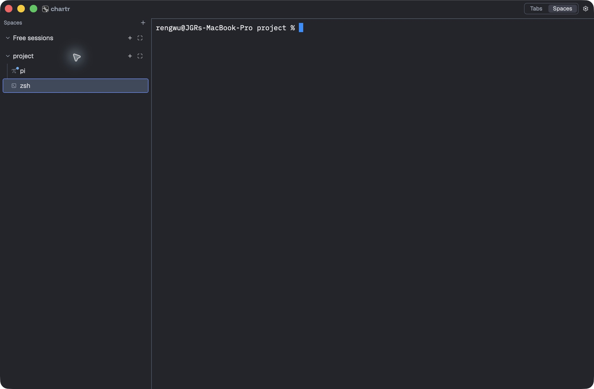
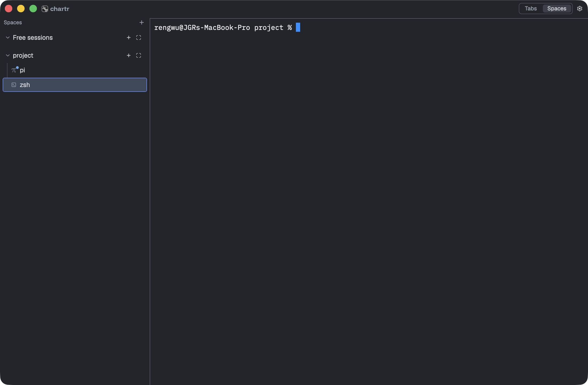

# Agent attention implementation recheck

The accepted attention policy is implemented. Automated checks and the selected
real Pi/native-dot checks pass. Overall **Untested**: desktop banners, notification
clicks and several native lifecycle/layout scenarios were not established.
The [earlier failed attempts](2026-10-14-agent-attention-attempts.md) remain intact.

## Scope and build

Related features: [agents](../../features/agents-inbox.md),
[terminals](../../features/terminals.md), [panes](../../features/panes.md).
The [accepted behavior](../../discussions/agent-attention.md#accepted-behavior)
and tracked-patch decision authorize this local implementation and verification.
No commit, publication or installed-app replacement was requested or performed.

- Chartr HEAD: `402ba90a25d82b527f68f23c1dc5f29e27065036`, dirty implementation.
- Herdr: `0.8.2-chartr.5a2dee700eee.attention.9854719ebce0`, protocol 22.
- Patch SHA-256: `9854719ebce086c54cf25ac273f9c9706514e24a8c7db63104999eab2a9b183f`.
- [Manifest](../../evidence/2026-10-14-agent-attention/manifest.json) records host,
  tool versions, final product-source hashes, binary hashes and dirty fingerprint.
  The full workspace suite preceded the final chrome polish; the final Chartr
  package tests and native bundle were rebuilt afterward.
- Final native app: `/tmp/ca-final-ve2jppdu/Chartr Verify.app`, unique bundle ID,
  explicit private XDG directories. [Instance identity](../../evidence/2026-10-14-agent-attention/ui-final-instance.json).
- Pi 0.99.2 ran offline with tools, automatic extensions, skills, prompt templates,
  themes and context files disabled. Only the bridge and harmless confirm fixture
  were loaded; no model request was sent. OpenCode was tested with callback fixtures.

## Results

| Scenario | Expected | Observed | Result |
| --- | --- | --- | --- |
| Workspace regression suite | No exercised regression | 427 passed, seven ignored across workspace and doc tests | Passed |
| Final Chartr package | Final chrome/source compiles and tests pass | 310 passed; four opt-in tests ignored | Passed |
| Attention policy and transport | Deduplication, focus, reconnect, retained unread, epoch/generation fences, bounded partial-frame handling | Five reducer tests, one persistence retry/order test and two client transport tests passed within the suites | Passed |
| Backend contract | Ordering, token invalidation, replay gaps and handoff invariants | Isolated run passed 2,817/2,819; both metadata failures corrected and their exact tests rechecked successfully. No second full 2,819-test sweep claimed. | Passed |
| Provider fixtures | Exclude cancellation, stale/root-mismatched events and duplicates | 31 JS/TS asset tests passed, including four attention-specific cases | Passed |
| Fetch and ancillary scripts | Patch identity/application failures preserve the prior executable | 15 Python tests passed; nine Linux-only packaging tests skipped. Nine fetch tests included. Node bridge/layout tests: ten passed. | Passed |
| Real Pi input requests | Distinct prompts create distinct attention occurrences | Three native confirm prompts produced revisions 1, 2 and 3 | Passed |
| Backend live handoff | Keep terminal, epoch, generation and latest attention | Final vendored-binary probe retained identity/latest; the next prompt after handoff was accepted | Passed |
| Native unread dot | Real input on another terminal adds an accent dot and accessible unread label | Pi gained both while zsh was selected in the final app | Passed |
| Native focus acknowledgment | Exact terminal focus in the active window clears its dot | Selecting Pi cleared the dot/label; SQLite acknowledged revision 1 | Passed |
| Relaunch restoration | Preserve unseen attention without advancing the notification watermark | After process termination and relaunch against the surviving backend, Pi's dot returned; the persisted attention value was identical | Passed |
| First authorization, banners and clicks | Visible OS notification and navigation to its exact terminal | Not observed. A delivery watermark establishes only an attempted OS call. Native click routing remains unverified. | Untested |
| Split/group, hidden/minimized/last-window operation | Only exact foreground focus acknowledges; monitoring survives window closure | Source implementation inspected, but these native scenarios were not established. The UI tool could reopen a closed window during observation. | Untested |
| Completion/failure in a real provider | Final outcome qualifies; cancellation does not | Installed Pi lacks the explicit aborted field, so these paths stay silent. Future-compatible Pi callbacks were tested only as fixtures; other providers have no qualified outcomes. | Untested |
| OpenCode runtime and Linux desktop delivery | Eligible requests and native delivery work on those environments | Callback fixtures only for OpenCode; no Linux desktop run | Untested |

Ignored tests and platform skips are coverage limits, not executed passes.
The SIGTERM restart proves persisted restoration; it does not prove the native
Quit shortcut or final graceful-quit flush. The writer ordering/retry test covers
the persistence mechanism independently.

## Implementation and evidence

Herdr owns process-bound producer registration, qualified events, atomic snapshots,
ordered deltas, gap recovery and identity-preserving live handoff. Only qualified
Pi/OpenCode integration events enter this store; existing status/screen fallback
does not create attention. The frozen TUI codec was not changed.

Chartr owns one app-lifetime feed, a pure attention reducer, separately persisted
acknowledgment/delivery watermarks, terminal/group dot projection, native delivery
and exact-terminal click navigation. Stale generations cannot resolve a click.
The patch hash is checked even when reusing a cached binary.

- [Workspace tests](../../evidence/2026-10-14-agent-attention/chartr-tests.log),
  [final package tests](../../evidence/2026-10-14-agent-attention/chartr-final-tests.log),
  [final build](../../evidence/2026-10-14-agent-attention/chartr-final-build.log).
- [Schema recheck](../../evidence/2026-10-14-agent-attention/backend-schema-final.log),
  [integration marker recheck](../../evidence/2026-10-14-agent-attention/backend-recheck.log),
  [asset tests](../../evidence/2026-10-14-agent-attention/asset-tests.log),
  [Python tests](../../evidence/2026-10-14-agent-attention/script-tests.log),
  [Node tests](../../evidence/2026-10-14-agent-attention/node-tests.log),
  [exact backend acquisition](../../evidence/2026-10-14-agent-attention/fetch-final.log).
- [Final Pi/handoff results](../../evidence/2026-10-14-agent-attention/pi-final-985-results.json)
  and [executed driver](../../evidence/2026-10-14-agent-attention/pi-probe-985.py.txt).
- [Native observations](../../evidence/2026-10-14-agent-attention/native-observations.json),
  [focus state](../../evidence/2026-10-14-agent-attention/ui-final-focused.json),
  [before relaunch](../../evidence/2026-10-14-agent-attention/ui-final-before-relaunch.json),
  [after relaunch](../../evidence/2026-10-14-agent-attention/ui-final-after-relaunch.json),
  [fixture control/state reader](../../evidence/2026-10-14-agent-attention/ui-final-request.py.txt).





## Executed commands and cleanup

```sh
cargo test --workspace --locked --no-fail-fast
cargo test -p chartr --locked
cargo build -p chartr --locked
cargo fmt --all --check
python3 -B -m unittest discover -s scripts/tests -v
node --test crates/chartr/tests/plugin_bridge.cjs plugins/wayfinder/tests/layout.test.mjs
ZIG=/opt/homebrew/opt/zig@0.15/bin/zig sh vendor/herdr/fetch.sh
```

Backend schema and integration tests ran in the patched disposable source tree;
asset tests used `npx --yes bun` because Bun was not installed. The evidence
drivers retain exact backend paths and flags. No full release matrix was run.

Both disposable native apps were stopped by exact process identity and their
private backends received `server.stop`. [Cleanup](../../evidence/2026-10-14-agent-attention/cleanup.json)
found no remaining run-owned processes or sockets. Probe servers also exited;
temporary profiles and this evidence remain on disk. `untitled` stayed untouched.

Next verification should use a notifications-enabled packaged app to observe the
first banner and click, then cover split/group focus and hidden/minimized/closed
windows. Provider coverage is documented in the
[public guide](https://github.com/rengwu/chartr/blob/main/docs/agent-attention.md).
