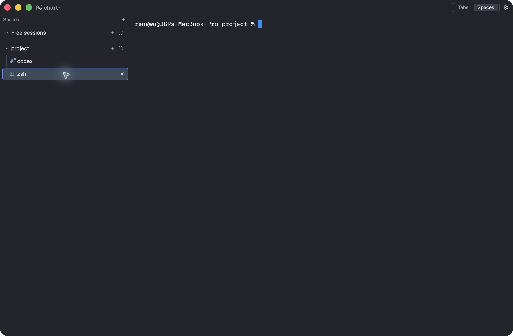

# Lean agent attention Codex recheck

The October 15 simplification is implemented. Automated checks and the selected
real Codex/native-state checks pass. Overall **Untested**: direct banner
inspection, native click navigation and parts of the layout/lifecycle/platform
matrix remain unverified. The [failed setup attempts](2026-10-15-lean-attention-attempts.md)
are retained separately; the [October 14 run](2026-10-14-agent-attention.md) covers
the superseded strict implementation only.

## Scope and build

Affected features: [agents](../../features/agents-inbox.md),
[terminals](../../features/terminals.md), [panes](../../features/panes.md).
[DEC-ATTENTION-005](../../decisions/index.md#dec-attention-005-reuse-existing-detection-with-best-effort-alerts)
accepts existing Herdr detection, false/missed alerts, one notification until the
terminal is visited, and Codex alone for initial live validation.

- Chartr HEAD: `402ba90a25d82b527f68f23c1dc5f29e27065036`, dirty implementation.
- Herdr: `0.8.2-chartr.5a2dee700eee.identity.9ed02822c877`, protocol 22.
- Patch SHA-256: `9ed02822c8773c63053cf4d42745fff8758ef5aa57ddb5d4c3c55eec56bdaf70`.
- macOS 27.0 (26A5368g), arm64, pinned Rust 1.96.0.
- [Manifest](../../evidence/2026-10-15-lean-attention/manifest.json) includes
  product-source and signed-binary hashes, the dirty-tree fingerprint captured
  before record finalization, and the exact instance identity.
- Final bundle: `target/lean-native/Chartr Lean Verify.app`, unique identifier
  `dev.chartr.leanverify.project.oct15`; private XDG root `/tmp/ca-lean-s4xq_16d`.
  The normal app build followed test compilation before the bundle was copied.
- Codex CLI 0.162.1 used the existing authenticated account and configured
  `gpt-6-astra`/xhigh model. Harmless prompts requested only `sleep`/`printf`.
  [Launcher](../../evidence/2026-10-15-lean-attention/run-codex.txt) disabled MCP
  servers/plugins per invocation, with read-only sandbox and on-request approvals.
  HOME and CODEX_HOME were not changed. Provider history remains outside XDG isolation.
- Herdr loaded its remote Codex detection manifest version `2026.10.11.1`;
  the [exact manifest](../../evidence/2026-10-15-lean-attention/codex-detection.toml.txt)
  is retained. This is not a bundled-manifest-only check.

## Results

| Scenario | Expected | Observed | Result |
| --- | --- | --- | --- |
| Workspace regression suite | No exercised regression | 425 passed, seven ignored | Passed |
| Attention policy and persistence | Once-until-visit, exact focus, silent baseline/reconnect, retained unread, stale-click rejection and ordered writes | Five model tests and one persistence retry/order test passed within the suite | Passed |
| Backend identity patch | Preserve terminal IDs and state invariants | One focused upstream test passed; actual live handoff retained both terminals and unread revision 1 | Passed |
| Fetch/build/scripts | Exact patch identity; failed build/application preserves old binary | Vendored build passed; 15 Python tests passed, nine Linux-only tests skipped, including nine passing fetch tests | Passed |
| Real Codex completion | Working-to-inactive on another tab marks unread | Sleep prompt produced idle state, unread revision 1 and native accent dot/accessibility label | Passed |
| Real approval request | Entry into blocked marks unread | Harmless explicit approval prompt produced blocked state and revision 2 | Passed |
| Coalescing and rearming | Another transition while unread does not notify again; a visit rearms | Approval and subsequent completion stayed revision 2; later visited-terminal completion created revision 3 | Passed |
| Cancellation heuristic | Measure the accepted false-alert risk | Escape during sleep led to idle and unread revision 4 | Passed |
| Exact foreground acknowledgment | Visiting Codex clears only its unread state | Dot/label disappeared and persisted unread became false; ordinary zsh stayed unmarked | Passed |
| Relaunch and handoff retention | Keep existing unread without a new episode | Persisted attention was unchanged across SIGTERM/relaunch against surviving backend; handoff retained terminal IDs/unread | Passed |
| Native notification authorization and acceptance | OS accepts the app's requests | Native permission prompt allowed; usernoted logged authorization, presentation of revisions 4–6, and removal when focused | Passed |
| Minimized monitoring | Activity remains monitored while minimized | With Finder observed instead of Chartr, completion created unread revision 5 | Passed |
| Last-window monitoring/reopen | Polling survives closing last window; exact focus acknowledges after reopen | After close, backend-driven Codex work created revision 6; Finder reopened the same PID and focused Codex, clearing unread | Passed |
| Visible banner and click routing | Inspect notice and click to its exact terminal | Notification Center access repeatedly timed out, including with unread revision 6 outstanding. OS presentation logs are not a visual/click check. | Untested |
| Native split/group acknowledgment | Opening a group or adjacent split does not acknowledge other terminals | Drag attempts did not establish the intended layout. Model focus-set tests pass but do not prove native integration. | Untested |
| Hide, graceful Quit and fully-quit monitoring | Accepted app-lifetime behavior | Hide not established; Cmd+Q through the tool did not establish exit. Cleanup used exact PID SIGTERM. | Untested |
| Other providers, Linux and full backend/release suites | Supported environments behave correctly | Outside this bounded Codex/macOS run; no full backend suite or release matrix rerun | Untested |

Ignored/skipped tests are coverage limits, not passes. This run does not classify
actual success or failure from heuristics. Relaunch retention and the pure model
establish no new episode; they do not prove the absence of a visible catch-up
banner. Process termination does not prove graceful quit-flush behavior.

## Implementation and evidence

Chartr owns one app-lifetime, namespace-wide `pane.list` poll about once a second.
It normalizes idle/done, marks working-to-inactive or entry into blocked, and
retains unread until exact foreground terminal focus. Startup and the first
successful read after an error establish a silent baseline. Short/interrupted
transitions can be missed. Notification tags contain terminal lifetime ID and
unread-episode revision, so an old notice cannot target a later episode.

The strict attention stream, registered producers, qualified outcomes and
provider adapters were removed. The tracked backend patch shrank from 1,936 to
135 lines and only preserves terminal IDs through live handoff. Version 1 of the
unreleased prototype's attention storage is reset; version 2 restores itself.

- [Workspace tests](../../evidence/2026-10-15-lean-attention/workspace-tests.log),
  [normal app build](../../evidence/2026-10-15-lean-attention/chartr-build.log),
  [backend build](../../evidence/2026-10-15-lean-attention/backend-build.log),
  [identity test](../../evidence/2026-10-15-lean-attention/identity-tests.log),
  [Python tests](../../evidence/2026-10-15-lean-attention/script-tests.log).
- [Activity observations](../../evidence/2026-10-15-lean-attention/observations.json),
  [approval](../../evidence/2026-10-15-lean-attention/approval-request.json),
  [coalescing](../../evidence/2026-10-15-lean-attention/coalesced.json),
  [cancellation](../../evidence/2026-10-15-lean-attention/cancellation.json),
  [focus](../../evidence/2026-10-15-lean-attention/focused.json).
- [Handoff](../../evidence/2026-10-15-lean-attention/handoff.json),
  [before relaunch](../../evidence/2026-10-15-lean-attention/before-relaunch.json),
  [after relaunch](../../evidence/2026-10-15-lean-attention/after-relaunch.json),
  [minimized](../../evidence/2026-10-15-lean-attention/minimized.json),
  [closed-window transitions](../../evidence/2026-10-15-lean-attention/closed-window-second.json),
  [same-process reopen](../../evidence/2026-10-15-lean-attention/reopened.json).
- [Filtered macOS notification log](../../evidence/2026-10-15-lean-attention/notifications.log)
  and [executed backend/state probe](../../evidence/2026-10-15-lean-attention/probe.py.txt).



## Commands and cleanup

```sh
ZIG=/opt/homebrew/opt/zig@0.15/bin/zig sh vendor/herdr/fetch.sh
cargo test --workspace --locked --no-fail-fast
python3 -B -m unittest discover -s scripts/tests -v
cargo build -p chartr --locked
cargo fmt --all --check
git diff --check
```

The focused upstream test used `cargo +1.96.0 test --locked
handoff_preserves_all_terminal_identities_and_invariants` in the patched source
cache, with the existing Herdr target directory. The full workspace suite and
focused handoff test used the final product sources.

[Cleanup](../../evidence/2026-10-15-lean-attention/cleanup.json) confirms no remaining
run-owned processes or private socket. Temporary alert-style changes were restored;
notification authorization remains specific to the disposable bundle. Test profiles
and evidence remain on disk. No installed app was replaced, commit created or
upstream submission made. The unrelated `untitled` file was untouched.

No consequential design choice remains for a grill. The next bounded check needs
a working native alert interaction route: click an actual current notice, verify
exact-terminal navigation and acknowledgment, then reject an old episode's notice.
The limits above do not require changing the accepted best-effort policy.
